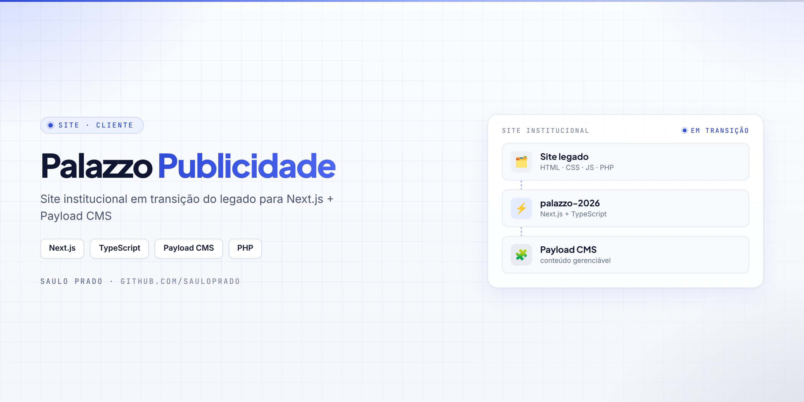
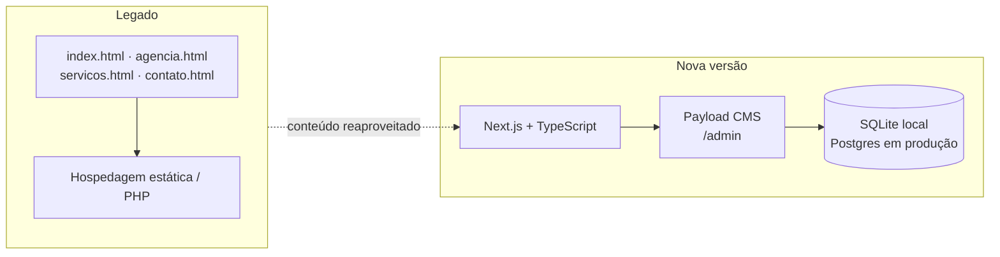

<p align="center">

</p>

<h1 align="center">Palazzo Publicidade</h1>
<p align="center"><i>Site institucional em transição do legado (HTML/PHP) para Next.js + Payload CMS</i></p>

<p align="center">


</p>

## Sumário

- [Sobre](#sobre)
- [Arquitetura](#arquitetura)
- [Tecnologias](#tecnologias)
- [Como executar](#como-executar)
- [Publicação](#publicação)
- [Estrutura do repositório](#estrutura-do-repositório)
- [Autor](#autor)

## Sobre

Repositório do site da **Palazzo Publicidade e Propaganda**. Mantém duas frentes no mesmo lugar:

- **Site legado** — HTML, CSS, JavaScript e PHP, para manutenção imediata e reaproveitamento de conteúdo
- **`palazzo-2026/`** — a nova versão, com Next.js, TypeScript e Payload CMS, preparada para um fluxo moderno de desenvolvimento e publicação

## Arquitetura



## Tecnologias

| Frente | Stack |
| --- | --- |
| Legado | HTML, CSS, JavaScript, PHP |
| Nova versão | Next.js, TypeScript, Payload CMS, pnpm |
| Banco | SQLite no desenvolvimento, Postgres recomendado em produção |

## Como executar

```bash
cd palazzo-2026
pnpm install
pnpm dev
```

| Endereço | O que é |
| --- | --- |
| `http://localhost:3000` | Site |
| `http://localhost:3000/admin` | Painel do Payload CMS |

| Script | Ação |
| --- | --- |
| `pnpm dev` | Ambiente de desenvolvimento |
| `pnpm build` | Build de produção |
| `pnpm start` | Sobe a aplicação compilada |
| `pnpm lint` | Validação de código |

## Publicação

1. **Legado** — publicar como site estático / PHP tradicional.
2. **Nova versão** — app em Vercel ou servidor Node, banco Postgres e uploads locais no início (storage externo depois).

> A raiz do repositório guarda histórico, backups e materiais de apoio do site antigo; nem tudo faz parte da versão final.

## Estrutura do repositório

```text
Palazzo/
├── palazzo-2026/        # nova versão (Next.js + Payload CMS)
├── index.html           # site legado
├── agencia.html
├── contato.html
├── portifolio.html
├── img/ · js/ · pagina/ # recursos do legado
├── doc/                 # materiais de apoio
└── assets/capa.png
```

## Autor

**Saulo Prado** · Analista de Sistemas · Gestão de Ativos de TI, orçamento, automação e dashboards

[](https://www.linkedin.com/in/saulo-prado-ab4a0b96/)
[](https://github.com/sauloprado)
